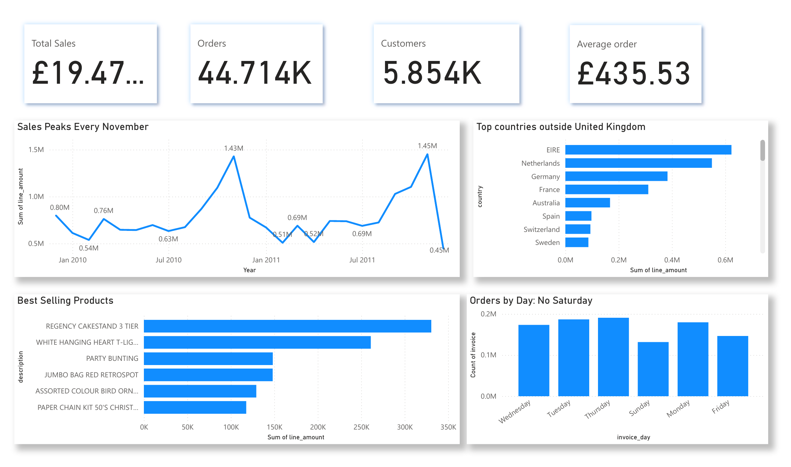
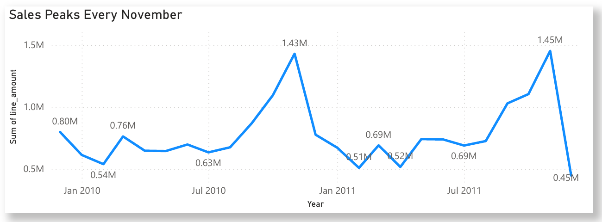

# Online Retail Analysis: A Customer and Revenue Review

**Power BI Analysis Project · Public data · UCI**

> **Summary:** Exploration of online retail sales data, highlighting customer concentration, international markets and seasonal demand.

[🌐 Project page](https://cjsmith-page.github.io/analysis/05-online-retail/) · [📊 Dashboard (PDF)](dashboard/PBI_Online_Retail_Analysis.pdf) · [🧾 SQL](sql/Onlineretailanalysis.sql)

---

## At a Glance

| | |
|---|---|
| **Problem** | A UK online gift retailer needed to know which customers, markets and seasons drive its revenue. |
| **Finding** | £19.47M across 44,714 orders. A £435.53 average order, office-hour buying and almost no Saturday trade reveal a wholesale business; ten customers generate about 14% of sales. |
| **Recommendation** | Look after the top accounts, stock up before September, grow overseas customers and flag unusually large orders. |

**Scope:** UK online retailer (UCI) · 44,714 orders · Dec 2009 – Dec 2011

## Key Findings

1. **This “gift shop” is a wholesale business.** The average order is £435.53, and orders arrive during office hours and almost never on Saturdays.  
   *Implication:* the business should be managed around trade accounts, not individual consumers.
2. **Christmas decides the year.** The five best months in the data all fall between September and November.  
   *Implication:* stock and staffing need to be in place before September.
3. **A few customers carry the business.** Ten customers generate about 14% of all sales.  
   *Implication:* losing a single key account would have a material impact.
4. **Some overseas accounts act like distributors.** Ireland is the second-largest market with only three customers, and Dutch orders average £2,545, five times the UK average.  
   *Implication:* a handful of international accounts can be worth more than whole countries.
5. **Big numbers need checking.** The third best-selling product turned out to be a single order of 80,995 paper craft kits, cancelled twelve minutes later.  
   *Implication:* rankings must exclude cancelled and erroneous orders before they are trusted.

## Recommendations

1. **Look after the top customers.** Give the biggest accounts a named contact and early access to new stock.  
   *Addresses finding 3 · **Measure:** revenue retained from the top ten customers.*
2. **Prepare for autumn early.** Stock up on best sellers before September, when the busiest months begin.  
   *Addresses finding 2 · **Measure:** stock availability during September to November.*
3. **Grow the overseas accounts.** Develop the few large international customers that behave like distributors.  
   *Addresses finding 4 · **Measure:** overseas revenue per account.*
4. **Check unusual orders.** Flag any order far larger than a customer’s normal size before it is processed.  
   *Addresses finding 5 · **Measure:** orders flagged and corrected before processing.*

## The Dashboard for Stakeholders

The dashboard brings the main answers together on one page. Four cards show total sales, orders, customers and average order value. A line chart shows monthly sales rising every autumn and peaking in November, and bar charts rank the top overseas markets and best-selling products.

Orders by weekday complete the picture: Thursday is the busiest day and Saturday is almost empty, which points to trade customers rather than the public. The mistaken 80,995-unit order is excluded so it cannot distort the product rankings.

## How the Analysis Was Done

The analysis was built in SQLite using DBeaver. The first step creates a clean sales table that keeps only real sales, removing cancelled orders, postage and fee lines and zero-price items, so every question works from the same reliable data.

Eleven questions then use straightforward SQL: SUM and COUNT for sales, orders and customers; GROUP BY and ORDER BY to rank countries, products and customers; HAVING to compare countries with enough orders; and strftime to look at sales by year, month, weekday and hour. Each query carries a comment stating what it found.

## Repository Contents

| Folder | What it holds |
|---|---|
| `dashboard/` | The Power BI dashboard: PDF, Power BI file (`.pbix`) and screenshots |
| `sql/` | The SQL behind the numbers, each query commented with its business question and result |
| `docs/` | the detailed write-up |

**Data source:** Data: [Online Retail II, UCI Machine Learning Repository](https://archive.ics.uci.edu/dataset/502/online+retail+ii) · Tools: SQLite (DBeaver) · Power BI · Excel

---

### Business Analysis Experience

[Collateral Discrepancy Investigation](https://github.com/CJsmith-page/ba-experience-collateral-investigation) · [SLA Performance Analysis](https://github.com/CJsmith-page/ba-experience-sla-performance) · [Screening Platform Request Delivery](https://github.com/CJsmith-page/ba-experience-screening-delivery) · [Requirements and Prototype Delivery](https://github.com/CJsmith-page/ba-experience-requirements-delivery)

### More Power BI Projects

[Consumer Complaints & Response SLA](https://github.com/CJsmith-page/powerbi-consumer-complaints) · [US Bank Consolidation & Branch Impact](https://github.com/CJsmith-page/powerbi-bank-consolidation) · [Financial Crime Analytics](https://github.com/CJsmith-page/powerbi-financial-crime) · [Hotel Booking Cancellations](https://github.com/CJsmith-page/powerbi-hotel-cancellations)

**Cudjoe John Smith** · Business Analyst · [Portfolio](https://cjsmith-page.github.io) · [GitHub profile](https://github.com/CJsmith-page) · [LinkedIn](https://www.linkedin.com/in/c-john-smith/)
